**Alban Billiette**, game security and full-stack developer at 42 Warsaw, open to full-time roles. My profile is written as a Windows debugger session: the bold lines say what each part is, and the blue names are links. [kaveo.dev](https://kaveo.dev) · [CV](https://kaveo.dev/Alban-Billiette-CV.pdf) · [contact@kaveo.dev](mailto:contact@kaveo.dev)

<pre>
0:000&gt; <b>* who I am, as raw bytes</b>
0:000&gt; db kaveo!bio
00403000  41 6c 62 61 6e 20 42 69-6c 6c 69 65 74 74 65 2c  Alban Billiette,
00403010  20 34 32 20 57 61 72 73-61 77 2e 20 49 20 72 65   42 Warsaw. I re
00403020  76 65 72 73 65 20 61 6e-74 69 2d 63 68 65 61 74  verse anti-cheat
00403030  73 2c 20 77 72 69 74 65-20 57 69 6e 64 6f 77 73  s, write Windows
00403040  20 6b 65 72 6e 65 6c 20-64 72 69 76 65 72 73 20   kernel drivers 
00403050  61 6e 64 20 73 68 69 70-20 66 75 6c 6c 2d 73 74  and ship full-st
00403060  61 63 6b 20 70 72 6f 64-75 63 74 73 2e 00 cc cc  ack products....

0:000&gt; <b>* what I did last on GitHub</b>
0:000&gt; .lastevent
Last event: release <a href="https://github.com/RUSTORIGIN/launcher/releases/tag/v1.3.3">v1.3.3</a> of <a href="https://github.com/RUSTORIGIN/launcher">RUSTORIGIN/launcher</a>
  debugger time: Thu Nov 12 03:00:42.000 2026 (UTC + 0:00)

0:000&gt; <b>* projects (click a name)</b>
0:000&gt; lm
start    end        module name
10000000 1004e000   <a href="https://kaveo.dev/work/rustorigin/">rustorigin</a>       anti-cheat for my own Rust servers. 318 bans in 30 days
10100000 1011c000   <a href="https://github.com/kaveOO/AssaultCubeDMA">assaultcubedma</a>   reads game memory over a PCIe DMA card, not the OS
10200000 10212000   <a href="https://github.com/kaveOO/kaveOS">kaveos</a>           x86 kernel from scratch in C and asm, no libc
10300000 10361000   <a href="https://kaveo.dev/work/rustaveo/">rustaveo</a>         paid SaaS for Rust players, built and run alone
10400000 10438000   <a href="https://github.com/kaveOO/Arbor">arbor</a>            booking engine, 1st on Track B at Codaro x Google
10500000 10523000   <a href="https://github.com/kaveOO/panomoche">panomoche</a>        sorts street pictures for Panoramax with ML

0:000&gt; <b>* how I got here, newest first</b>
0:000&gt; k
 # ChildEBP RetAddr
00 0019fe60 00401d9e kaveo!codaro_google_hackathon+0x1f2   1st place, booking track   2026
01 0019febc 0040147c kaveo!warsaw_hacks+0xa4               most innovative idea       2026
02 0019ff18 00402a40 kaveo!common_core_le_havre+0x3c0      42 Common Core done        2026
03 0019ff74 00401134 kaveo!main+0x2c                       first line of code     oct 2024
04 0019ffd0 00000000 ntdll!RtlUserThreadStart+0x2f

0:000&gt; <b>* where to reach me</b>
0:000&gt; du kaveo!contact
00405000  site     "<a href="https://kaveo.dev">kaveo.dev</a>"
00405040  cv       "<a href="https://kaveo.dev/Alban-Billiette-CV.pdf">kaveo.dev/cv.pdf</a>"
00405080  mail     "<a href="mailto:contact@kaveo.dev">contact@kaveo.dev</a>"
004050c0  linkedin "<a href="https://www.linkedin.com/in/kaveooo/">linkedin.com/in/kaveooo</a>"
00405100  youtube  "<a href="https://www.youtube.com/@Kaveo_o">youtube.com/@Kaveo_o</a>"
00405140  discord  ".kaveo"

0:000&gt; qd
</pre>

<picture>
  <source media="(prefers-color-scheme: dark)" srcset="assets/memory-dark.svg">
  <source media="(prefers-color-scheme: light)" srcset="assets/memory-light.svg">
  
</picture>
